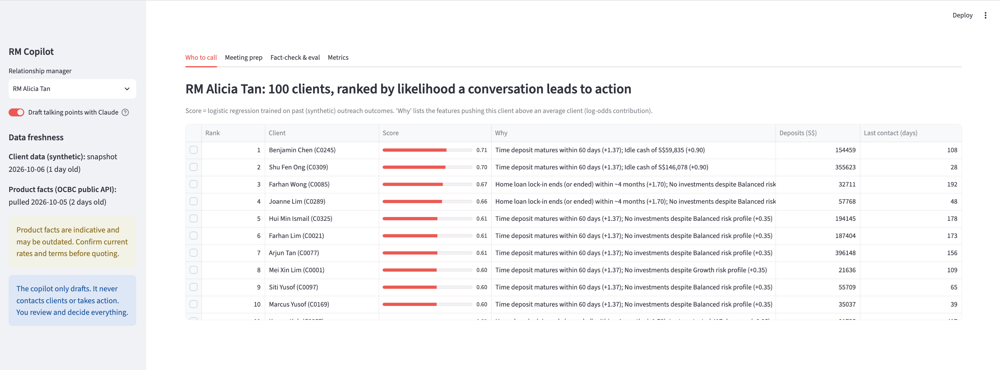
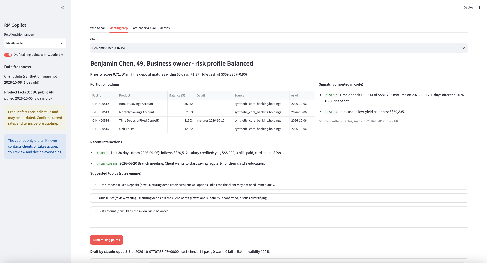
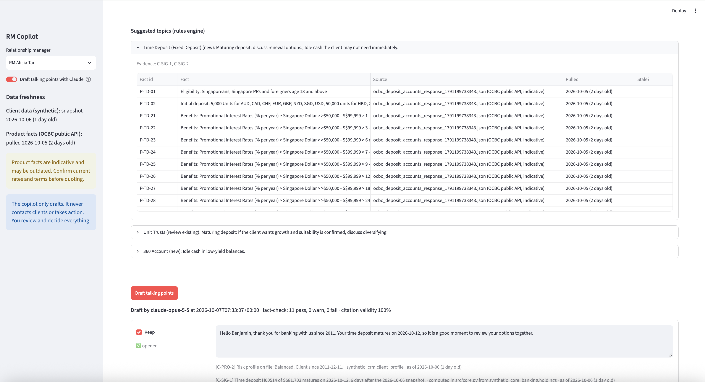
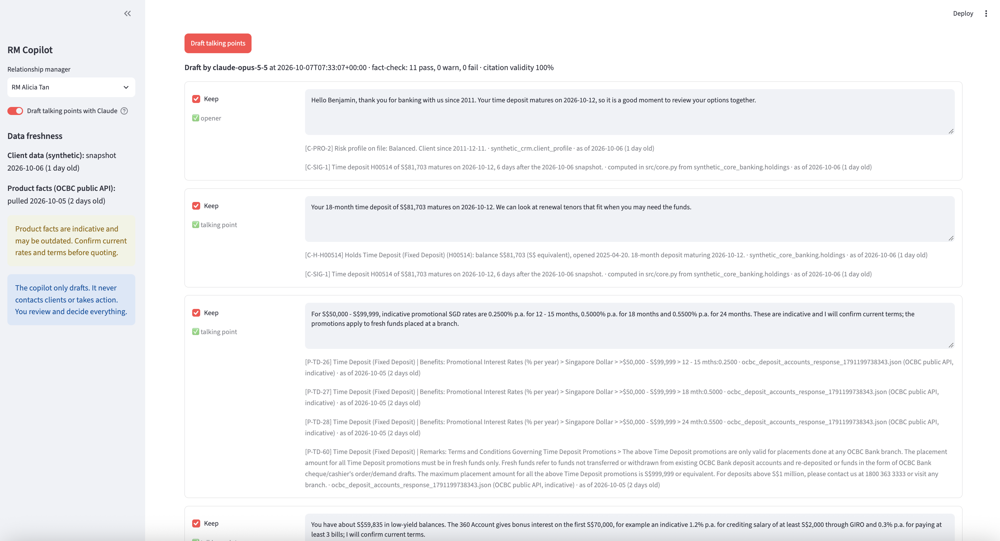
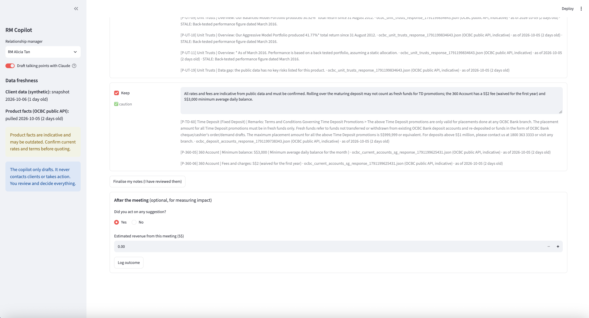
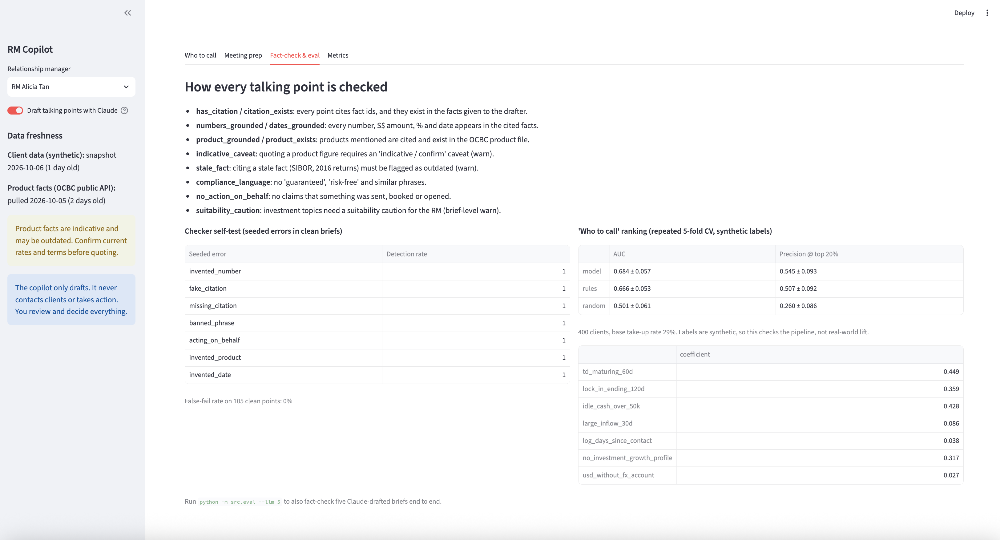
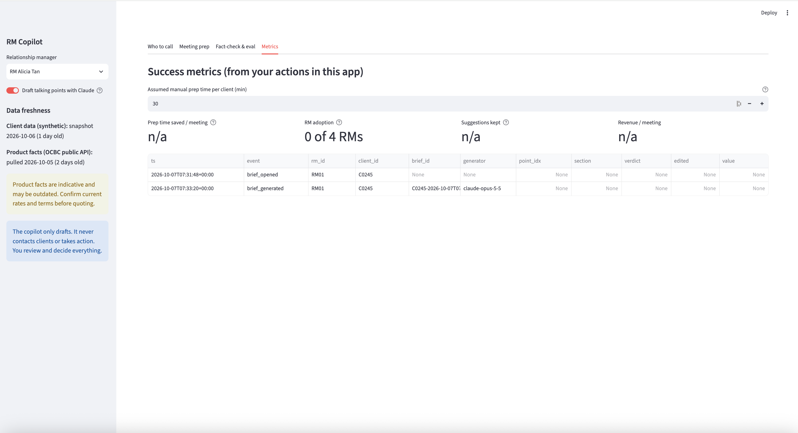

# RM copilot: who to call, and what to say (prototype)

A copilot for relationship managers (RMs) who have too many clients to prepare for. It ranks an RM's book by **who
needs attention** and explains why, summarises each client's **portfolio holdings** and recent activity, and drafts
**talking points** with Claude. Every claim cites a source fact with its date, and a plain-code fact-checker tests
every point before the RM sees it.

**The copilot never acts for the RM.** It doesn't contact clients, send messages or book anything. The RM ticks,
edits and finalises the notes, and decides what (if anything) to say.

> **Unofficial prototype.** Not affiliated with or endorsed by OCBC. **All client data is synthetic.** Product facts
> come from OCBC's public product API (10 deposit, loan and investment products), pulled 5 Oct 2026. They are
> indicative and may be outdated: confirm current rates and terms before quoting any figure.



<details>
<summary>More screenshots: meeting prep, cited talking points, fact-check and metrics</summary>

**Client profile:** holdings with fact ids, source and date; signals computed in code; recent interactions:



**Suggested topics:** each rule's reasons and evidence ids, with the product facts it draws on and how old they are:



**Talking points drafted by Claude:** each point has a fact-check verdict, a Keep box, editable text and its cited
facts with source and date:



**Cautions, finalise and after the meeting:** stale facts are labelled; the RM finalises, then logs the outcome:



**Fact-check & eval:** the checks, the seeded-error self-test and the ranking evaluation:



**Metrics:** success metrics from the event log (taken before any brief was finalised, so most tiles show n/a):



</details>

## How it works
1. **Synthetic book:** `src/data_gen.py` makes 4 RMs and 400 clients with 851 holdings of the real product names,
   30-day activity, interaction notes and past outreach outcomes. Every row carries `source` and `as_of`
   (snapshot 6 Oct 2026).
2. **Product fact sheets:** `src/core.py` splits `data/products_clean/products.json` into 194 small facts, each with
   an id (`P-TD-26`), source file and pulled date. Nested bullets keep their headings, e.g.
   "Singapore Dollar > >$50,000 - S$99,999 > 12 - 15 mths:0.2500". Stale facts (SIBOR, 2016 back-tested returns) are
   tagged, and missing key risks become an explicit "data gap" fact.
3. **Client summary, computed in code:** profile, holdings, activity, the last 3 interactions and signals (deposit
   maturing, home-loan lock-in ending, idle cash, large inflow, USD inflows without an FX account, no investments).
   Each line is a citable fact (`C-H-H00405`, `C-SIG-2`) with its source and date.
4. **Who to call:** a logistic regression on past (synthetic) outreach outcomes. Each client shows the features that
   push them above an average client, e.g. "Time deposit matures within 60 days (+1.37)".
5. **What to suggest:** an explicit rule table maps signals and notes to products, with reasons and evidence ids.
   Unit trusts are never suggested to conservative clients.
6. **What to say:** Claude (`claude-opus-5-5`, low effort, structured output, server-side refusal fallback) writes an
   opener, talking points, questions and cautions using **only** the facts given, citing fact ids. A 60 s timeout and
   a try/except fall back to template points, so the app never crashes.
7. **Fact-check:** `src/eval.py` checks every point:
   - cites facts, and the cited ids exist;
   - every number, S$ amount, % and date appears in the cited facts;
   - products mentioned are cited and exist;
   - product figures carry an "indicative / confirm" caveat;
   - stale facts are flagged as outdated;
   - no "guaranteed" / "risk-free" language;
   - no claims that something was sent, booked or opened;
   - investment topics come with a suitability caution.

   The RM's edited notes are re-checked when they finalise.

## Results
From [`data/eval/SUMMARY.md`](data/eval/SUMMARY.md):

| Evaluation | Result |
|---|---|
| Fact-checker on 7 seeded error types (invented number, date or product; fake or missing citation; banned phrase; acting on the RM's behalf) | 100% detected; 0% false fails on 105 clean points |
| 3 Claude-drafted briefs, fact-checked end to end | 0% fallback, 100% valid citations, 91% of points pass outright, 1 fail caught |
| "Who to call" ranking, repeated 5-fold CV | AUC 0.68 ± 0.06 vs 0.67 ± 0.05 for a count-of-signals rule and 0.50 random |

**The ranking result is weak evidence.** The labels come from a rule we wrote, and the model is only marginally ahead
of the simple rules baseline, within noise. Both clearly beat random.

## Success metrics
The app logs RM actions to `data/feedback/events.csv` (gitignored) and the Metrics tab shows:

| Metric | How it's measured here |
|---|---|
| Prep time saved | Assumed manual baseline (default 30 min) minus median time from opening a client to finalising |
| RM adoption | RMs who finalised at least one brief |
| Share of suggestions acted on | Points kept out of points drafted, plus "acted on" from the post-meeting outcome form |
| Revenue per meeting | Mean of RM-entered revenue in the outcome form |

## Run it
Python 3.11 and an [Anthropic API key](https://console.anthropic.com/).

```bash
python3.11 -m venv .venv && source .venv/bin/activate
pip install -r requirements.txt
echo 'ANTHROPIC_API_KEY=your-key-here' > .env   # gitignored; never commit it

python -m src.data_gen          # synthetic book -> data/synthetic/ (~2 s; also built on first use)
python -m src.core              # fact sheets, ranking, one client summary and template brief
python -m src.eval              # fact-checker self-test + ranking CV -> data/eval/ (~4 s, no API calls)
python -m src.eval --llm 3      # also fact-check 3 Claude-drafted briefs (~15 s each)
streamlit run app.py
pytest tests/ -v                # 6 tests (~6 s, no API calls)
```

Without a key, everything runs and the app uses template talking points with a notice. The model defaults to
`claude-opus-5-5`; set `RM_COPILOT_MODEL` in `.env` to change it.

## Files
| File | What it does |
|---|---|
| `app.py` | Streamlit UI: who to call, meeting prep (holdings, signals, suggestions, cited points, keep/edit/finalise, outcome form), fact-check & eval, metrics. |
| `src/data_gen.py` | Synthetic RMs, clients, holdings, activity, interactions and past outreach outcomes. |
| `src/core.py` | Fact sheets, client summary and signals, priority model with reasons, product rules, Claude drafting with template fallback, event log. |
| `src/eval.py` | Fact-checker, seeded-error self-test, ranking CV, optional end-to-end Claude eval, `SUMMARY.md`. |
| `scripts/clean_products.py` | Cleans OCBC's raw product API JSON into `data/products_clean/`. |
| `tests/test_copilot.py` | Facts carry source and date; template briefs pass; checker catches errors; AI-off and API-failure fallbacks; headless app smoke test. |

See [`HANDOFF.md`](HANDOFF.md) for assumptions, known shortcuts and what productionising would take, and
[`docs/SESSION_LOG.md`](docs/SESSION_LOG.md) for how it was built.
